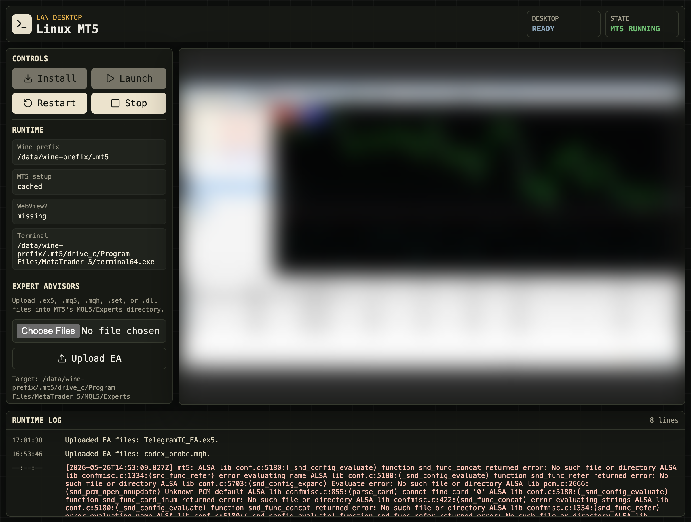

# Linux MT5

Linux MT5 is a Docker-hosted browser desktop for running MetaTrader 5 on Linux
through Wine. It exposes the virtual desktop through noVNC and provides a small
Bun/React control surface for first-run installation, launching, stopping, and
restarting MT5.

This project follows the official MetaQuotes Linux approach: MetaTrader 5 runs
on Linux through Wine, and the MT5 installer remains a GUI installer. The Docker
image therefore installs Wine and the desktop runtime, while the MT5 installer
runs on first use inside the browser desktop and persists into a Docker volume.



*The control surface: install / launch / stop / restart, runtime status, EA
upload, the embedded noVNC desktop (blurred here), and a live runtime log.*

## Architecture

```text
apps/web
  React + Vite control surface with embedded noVNC

apps/server
  Bun API and MT5/Wine process supervisor

packages/shared
  Runtime status schemas and shared helpers

docker
  Xvfb, openbox, x11vnc, websockify, Wine, and Bun startup
```

Runtime processes:

- `Xvfb` provides the virtual Linux display.
- `openbox` manages windows inside the virtual desktop.
- `x11vnc` exposes the X display as VNC.
- `websockify` serves noVNC in the browser with heartbeat pings.
- Wine runs WebView2 setup, the MT5 installer, and `terminal64.exe`.

## Requirements

- Docker with Compose (v2).
- ~3–8 GB of free disk space for the image, Wine prefix, and MT5 data.
- RAM and CPU are not constrained by the Compose file — adjust via Docker
  resource limits if needed.

## Quick Start

Only Docker with Compose v2 is required to run the container — the image build
installs Bun, Wine, and the desktop runtime itself. The Bun steps below are
**optional** local checks for development before building the image, and need
Bun on the host only if you run them:

```bash
bun install
bun test
bun run typecheck
bun run lint
bun run build
```

Build and run the image:

```bash
docker build --platform linux/amd64 -t linux-mt5 .
docker compose up -d
```

For hosts with legacy Compose:

```bash
docker-compose up -d --build
```

Open:

- Control UI: `http://localhost:17300`
- noVNC directly:
  `http://localhost:17080/vnc.html?autoconnect=1&resize=scale&path=websockify`
- Raw VNC/RFB for local stream tools: `localhost:15900`

## Home Server Deployment

Set environment variables, or create a `.env` file in `linux/` next to
`docker-compose.yml` (that is where Docker Compose reads it from), before
deploying:

```text
APP_PORT=17300
NOVNC_PORT=17080
VNC_PORT=15900
LINUX_MT5_CONTAINER_NAME=linux-mt5
MT5_DATA_DIR=/path/to/linux-mt5-data
PUBLIC_NOVNC_URL=http://<your-host-ip>:17080/vnc.html?autoconnect=1&resize=scale&path=websockify
```

Deploy to the target server (adjust host, user, and paths):

```bash
rsync -az --delete --exclude node_modules --exclude dist --exclude dist-types \
  ./ user@<your-host>:/opt/linux-mt5/

ssh user@<your-host> 'cd /opt/linux-mt5 && docker-compose up -d --build'
```

## Streaming With rdp-stream-studio

The container publishes raw VNC/RFB on `VNC_PORT` for local stream tools. Point
`rdp-stream-studio` at this raw VNC endpoint, not at the noVNC browser URL:

```text
Source type: VNC
Host: <your-host-ip>
Port: 15900
Password: leave empty
```

For the home server used during this setup, that means:

```text
Host: 192.168.0.100
Port: 15900
```

The noVNC URL on `NOVNC_PORT` is still useful for browser control, but it is an
HTTP/WebSocket wrapper around VNC. TigerVNC and other VNC clients need the raw
`host:port` endpoint.

## First Run

With `AUTO_INSTALL_MT5=true` (the default), the container installs MetaTrader 5
by itself on first boot using the unattended `mt5setup.exe /auto` flow — no
clicking required — and auto-launches it when `AUTO_LAUNCH_MT5=true`. Watch
progress in the control UI's runtime log.

To install manually instead, set `AUTO_INSTALL_MT5=false` and:

1. Open the control UI.
2. Click `Install`.
3. Wait for the MetaTrader 5 installer flow to start.
4. The unattended installer completes on its own; click `Launch` after
   `terminal64.exe` is detected.

The container also exposes a Docker `HEALTHCHECK` (polls `/api/health`), so
`docker ps` shows health and orchestration can react to a stuck container. The
health endpoint returns 503 when MT5 is in a failed state, including an
unrequested clean exit or detached terminal disappearance, or when the
configured EA has a recorded initialisation failure or removal. Docker
`restart: unless-stopped` restarts an exited container; it does not restart a
container solely because the healthcheck fails.

The Wine prefix is persisted at:

```text
/data/wine-prefix/.mt5
```

When using the default Compose file this is backed by the host directory
configured via `MT5_DATA_DIR`.

## Expert Advisors

### Control Room files and clipboard

The desktop stays mounted while you switch contextual drawers. The command bar
shows terminal process state, configured-EA journal evidence and an explicitly
unverified heartbeat separately. Stop and Restart ask for confirmation; reloading
the desktop view does not restart MT5. Focus hides tools without disconnecting
the desktop. Scaling and remote keyboard controls remain inside noVNC, or use
**New tab** for its full interface. Activity is collapsed by default.

**Files** browses only the active MT5 data folder. Paste a relative destination
such as `MQL5/Experts/MyEA`, or that folder's absolute Linux/Windows path. Folder
navigation and Go do not create or change files. New destinations are created
only during apply. Links cannot be traversed. History, logs and tester/cache
locations are browse-only; this is not a host filesystem or shell console.

Choose files/folders, drop them or paste file data when the browser exposes it.
Selection alone does not upload; **Stage to destination & review**, an explicit
drop or file paste stages the transfer and opens Import. The pasted folder name
is retained below the chosen destination. If the browser only provides path text,
use Choose folder instead: a path pasted from your computer cannot grant the
browser filesystem access. Config destinations still require explicit account
restore; account protection, checksum, conflict, backup and stopped-terminal
checks are unchanged. Existing staged imports must be reviewed or cancelled
before starting another transfer.

**Clipboard** is a manual text bridge, not a file clipboard. Send updates the
desktop's X11 CLIPBOARD selection (Wine maps it to Windows); click in MT5 and use
Ctrl+V or Paste. Sending never injects keystrokes or submits a form. Get reads text
you copied in the desktop into the browser text box. Your device clipboard is
accessed only after an explicit browser-clipboard button click. On insecure LAN
URLs or denied permissions, paste directly into the box or use Select text and
Ctrl/Cmd+C. Transfers are limited to 64 KiB of UTF-8 text and are not logged.
Do not copy broker passwords into the control surface unnecessarily.

The runtime image installs `xclip`; a web-only update of an older image reports
the missing utility instead of pretending the bridge worked. Utility detection
does not prove native X11/Wine access; the first successful send/get does. The
service still needs a trusted network boundary/authenticated proxy as documented
under Security Notes.

Expert Advisors can run under Wine when they are custom/non-DRM builds and do
not depend on unsupported Windows APIs or CPU features unavailable on the host.
Commercial MQL5 Market EAs, EAs with native DLL dependencies, and binaries
compiled for newer CPU instruction sets may still fail. Use the Windows setup
(`../windows/`) only when you really need those Windows-specific behaviours,
because the Windows container uses gigabytes of RAM rather than the lighter
Linux/Wine footprint.

The upload endpoint is still available for compiled indicators and scripts
(`.ex5`). Files are written into the active terminal data folder under
`MQL5/Experts`:

```text
/data/wine-prefix/.mt5/drive_c/users/root/AppData/Roaming/MetaQuotes/Terminal/<terminal-id>/MQL5/Experts
/data/wine-prefix/.mt5/drive_c/Program Files/MetaTrader 5/MQL5/Experts
```

The official MetaQuotes installer can run in a portable-style layout where
`Config/common.ini` and `MQL5/Experts` live under the install folder in
`Program Files`. Broker-branded installs may instead use the roaming MetaQuotes
terminal folder. The app resolves one data directory associated with the selected terminal
installation. Roaming data directories are matched through MT5's `origin.txt`;
ambiguous matching directories cause an explicit error. Uploads, startup config
and generated presets use that same resolution.

The upload endpoint accepts common EA-related files:

```text
.ex5 .mq5 .mqh .set .dll
```

In the control UI, the EA upload panel shows the detected `Target:` path before
and after upload. That is the exact folder the app writes into.

If the terminal data folder is missing, the upload button cannot resolve a
target yet. Launch MT5 once from the control UI, let MetaTrader finish creating
its `MQL5/Experts` folders, then retry the upload. After that first run, the
upload button should work normally and show the detected `Target:` path.
Restart MT5 after uploading compiled EAs if the Navigator does not refresh.

### Data-folder imports

Use **Import MT5 data folder** for the folder opened by **File → Open Data
Folder**, not the installation directory containing `terminal64.exe`. A folder
picker or ZIP preserves nested EAs, indicators, libraries, include files, custom
data, presets, profiles and templates. Selecting `MQL5` itself also works.

1. Select the data folder or ZIP. Uploading is staging only and is allowed while
   MT5 runs. The preview shows the resolved destination, conflicts and exclusions.
2. Leave **Overwrite existing files** off to keep existing files. Enable it to
   replace conflicts, with a backup made first.
3. Leave **Restore uploaded Config** off to keep this terminal's saved account.
   Enable it only when deliberately restoring the source terminal's configuration,
   which can replace account, server and saved-password settings.
4. Stop MT5 explicitly before applying. Applying leaves MT5 stopped; launch it
   yourself after checking the import result. No EA is compiled or auto-attached.

Uploads use 4 MiB requests so large folders do not require one oversized proxy
request. Folder imports accept up to 10,000 files and 1 GiB of accepted contents.
ZIPs are unpacked in the browser, limited to 128 MiB compressed / 256 MiB expanded;
use folder selection for larger imports. ZIP64, encrypted archives and symlinks
are rejected. ZIP names must be ASCII or explicitly UTF-8; use folder selection
for archives with legacy filename encodings. Streaming inflate also bounds actual
expanded bytes rather than trusting archive metadata. Traversal, duplicate Windows paths and symlink destinations are
rejected by the server. Logs, history, tester/cache files, executables and
`origin.txt` are excluded. Existing files are never deleted to mirror a source.

Staging and backups live under `/data/imports`, with private directory permissions
because they may contain account configuration. One staged import is allowed at
a time; cancel it before starting another. Staged imports expire after 24 hours,
but must be cancelled explicitly to remove their data. Successful backups remain
under `/data/imports/backup-<id>-<attempt>`; retain or remove them according to your backup
policy. A failed apply attempts rollback. If the process is interrupted mid-apply,
launch is blocked until **Recover previous data** restores the pre-import files.
Recovery requires MT5 to be stopped too. Do not edit the data folder externally
while applying or recovering an import.

The uploader computes SHA-256 while sending each file; the server verifies the
staged bytes on completion and again before apply. Backups and replacement files
are synced before the recovery journal is removed. Filesystem/hardware durability
still depends on the host's storage correctly honouring flushes. Profile imports
merge files, not entire directories: review same-named chart profiles carefully
to avoid unintentionally mixing existing and imported charts.

### Resume the last account and charts

`MT5_SESSION_MODE=restore` is the default from version 3. It starts the existing
terminal without rewriting `common.ini`, generating presets or replaying the
Compose `[StartUp]` block. MT5 restores its own saved account and chart profile.
For portable-style installs that require `/config` to select the saved login,
the launcher uses a private UTF-16 copy of the persisted settings under
`/data/cache/session-restore.ini`, with every `[StartUp]` section removed. The
terminal's own configuration and account files are not rewritten by the launcher.
The full Wine prefix, registry, terminal data and HOME persist under the existing
`MT5_DATA_DIR:/data` mount. Use the same host directory on container recreation;
a Docker image alone does not contain your runtime account state. Enable
**Save password** in MT5. The launcher does not request or log broker passwords.

Graceful shutdown now ends the Wine session before removing the desktop, giving
MT5 time to flush account and chart state. Abrupt power loss cannot preserve
unsaved changes. Migrating account files from another machine is not equivalent
to retaining the same Wine prefix: saved credentials may be machine-bound and
require a one-time login. This is not a VM memory snapshot or a heartbeat guarantee.

### Managed common.ini and EA Presets

Set `MT5_STARTUP_CONFIG=true` to have the container update the active
terminal's persisted `config/common.ini` before launching MT5. The update keeps
account login, server, encrypted WebRequest allow-list, and other terminal state
inside the mounted Wine prefix, then overlays the low-resource chart settings
and optional EA startup settings controlled by Compose.

This behaviour is opt-in: also set `MT5_SESSION_MODE=managed`. It does not run
in the default restore mode, where the last saved terminal session takes priority.

The shared `docker-compose.yml` intentionally does not include these optional
EA and `common.ini` variables, because they are account- and EA-specific. Put
them in a local `docker-compose.override.yml` file next to `docker-compose.yml`.
That file is ignored by git.

No separate startup INI is created. The app launches `terminal64.exe` with
MetaTrader's `/config:` flag pointing at that active `common.ini`, which is what
causes MetaTrader to execute the `[StartUp]` block. Empty startup values are
ignored. That means the container can manage resource settings without adding a
`[StartUp]` block, and EA autoload only turns on when `MT5_STARTUP_EXPERT` is
set. Any existing `[StartUp]` block is replaced by the Compose-managed settings
so stale EA autoload values do not linger.

Example `docker-compose.override.yml` for auto-loading an EA:

```yaml
services:
  linux-mt5:
    environment:
      MT5_STARTUP_CONFIG: "true"
      MT5_SESSION_MODE: "managed"
      MT5_STARTUP_EXPERT: "TelegramTC_EA"
      MT5_STARTUP_SYMBOL: "XAUUSDr"
      MT5_STARTUP_PERIOD: "H1"
      MT5_STARTUP_PRESET: "TelegramTC_EA.generated.set"
      MT5_PRELOAD_CHARTS: "0"
      MT5_EA_BackendBaseUrl: "${MT5_EA_BACKEND_BASE_URL:?required}"
      MT5_EA_LinkCode: "${MT5_EA_LINK_CODE:?required}"
      MT5_EA_PollSeconds: "${MT5_EA_POLL_SECONDS:-1}"
      MT5_EA_HeartbeatSeconds: "${MT5_EA_HEARTBEAT_SECONDS:-5}"
```

For a hand-authored preset, set `MT5_STARTUP_PRESET` to that file and leave
all `MT5_EA_*` entries out. Supplying `MT5_EA_*` tells the launcher to generate
and overwrite the named preset. For SaaS deployments, keep tenant values in a
separate ignored `tenant.env` and run `docker compose --env-file tenant.env up
-d`; `${VAR:?required}` makes missing credentials fail before startup.

`MaxBars` is intentionally pinned to `5000` when startup config management is
enabled. Any environment variable beginning with `MT5_EA_` is written into the
generated EA preset after the prefix is removed. For example,
`MT5_EA_LinkCode` becomes `LinkCode=...` in
`MQL5/Presets/TelegramTC_EA.set`.

The example above is for one specific EA (`TelegramTC_EA`); its `MT5_EA_*` lines
are that EA's own inputs. To autoload **your own** EA instead:

1. Upload or mount the compiled `.ex5` into `MQL5/Experts`.
2. Set `MT5_STARTUP_EXPERT` to the file name without `.ex5`.
3. Set `MT5_STARTUP_SYMBOL` and `MT5_STARTUP_PERIOD` for the chart that should
   open.
4. Set `MT5_STARTUP_PRESET` if the EA should load a preset file.
5. Add one local override entry per EA input using `MT5_EA_<InputName>` (the
   prefix is stripped, so `MT5_EA_LinkCode` becomes `LinkCode=` in the preset).
6. Recreate the container with `docker compose up -d` to apply the new
   `[StartUp]` block.

## Configuration

The project defaults to the HFM SA5 MT5 installer (`hfmarketssa5setup.exe`)
because it installs cleanly under Wine with no extra workarounds. This is just
the MT5 terminal — once installed you can log in with **any** broker account
or trading server. To use a different installer, set `MT5_INSTALLER_URL` to
your broker's MT5 download link.

For broker-neutral testing, use the official MetaQuotes installer URL:

```text
MT5_INSTALLER_URL=https://download.terminal.free/cdn/web/metaquotes.ltd/mt5/mt5setup.exe
```

The image uses the WineHQ stable branch (Wine 11) on Debian Bookworm with a
`win64` prefix. Before installation it applies the Wine registry compatibility
settings needed by current MT5 installers. Mono/Gecko prompts can be suppressed
via `WINEDLLOVERRIDES` for the official installer.

Useful environment variables:

```text
APP_PORT=17300
NOVNC_PORT=17080
VNC_PORT=15900
LINUX_MT5_CONTAINER_NAME=linux-mt5
MT5_DATA_DIR=/path/to/linux-mt5-data
PUBLIC_NOVNC_URL=http://<your-host-ip>:17080/vnc.html?autoconnect=1&resize=scale&path=websockify
WEBSOCKIFY_HEARTBEAT_SECONDS=30
ENABLE_AUDIO=false
AUTO_LAUNCH_MT5=true
MT5_SESSION_MODE=restore
AUTO_INSTALL_MT5=true
AUTO_LAUNCH_DELAY_MS=2500
MT5_WINEBOOT_TIMEOUT_MS=900000
MT5_WINECFG_TIMEOUT_MS=180000
MT5_WEBVIEW2_TIMEOUT_MS=600000
MT5_STOP_TIMEOUT_MS=20000
MT5_RECONCILE_INTERVAL_MS=10000
MT5_INSTALLER_URL=https://download.terminal.free/cdn/web/12040/mt5/hfmarketssa5setup.exe
MT5_INSTALL_WEBVIEW2=false
WEBVIEW2_INSTALLER_URL=https://msedge.sf.dl.delivery.mp.microsoft.com/filestreamingservice/files/f2910a1e-e5a6-4f17-b52d-7faf525d17f8/MicrosoftEdgeWebview2Setup.exe
```

### Optional S3 tick-CSV sync

The container can mirror exported tick CSVs to S3. It is **off by default**.
Turn it on by setting the flag and the destination (directly, via an
`--env-file`, or by copying `docker-compose.override.yml.example` to
`docker-compose.override.yml` and uncommenting the S3 block):

```text
S3_SYNC_ENABLED=true                 # the feature flag
S3_URI=s3://your-bucket/ticks        # required when enabled
S3_SYNC_SOURCE_DIR=/data/exports     # container path MT5 exports CSVs into
S3_SYNC_INTERVAL_SECONDS=60
S3_SYNC_SETTLE_SECONDS=60             # defer upload while a CSV is still changing
```

In MT5's tick-export Save dialog, save the CSV into the directory that maps to
`S3_SYNC_SOURCE_DIR` (the default `/data/exports` is the host `MT5_DATA_DIR`
`exports/` folder). A loop runs `aws s3 sync` of `*.csv` on the interval.

Credentials: on EC2 with an attached instance role, leave the AWS values unset
and ensure the instance metadata **hop limit is >= 2** so the container can
reach the role. Off-AWS, provide them (session token only for temporary keys):

```text
AWS_DEFAULT_REGION=us-east-1
AWS_ACCESS_KEY_ID=...
AWS_SECRET_ACCESS_KEY=...
AWS_SESSION_TOKEN=...
```

For the **official** MetaTrader 5 installer instead of the HFM default, also set:

```text
MT5_INSTALLER_URL=https://download.mql5.com/cdn/web/metaquotes.software.corp/mt5/mt5setup.exe
WINEDLLOVERRIDES=mscoree=d;mshtml=d   # suppress the headless Wine Mono/Gecko prompts
```

## API

```text
GET  /api/health
GET  /api/status
GET  /api/runtime-config
GET  /api/mt5/experts
POST /api/mt5/experts
POST /api/mt5/install
POST /api/mt5/launch
POST /api/mt5/stop
POST /api/mt5/restart
GET  /api/mt5/imports
POST /api/mt5/imports
GET  /api/mt5/imports/<id>
POST /api/mt5/imports/<id>/chunk?index=<file-index>&offset=<bytes>
POST /api/mt5/imports/<id>/apply
POST /api/mt5/imports/<id>/cancel
POST /api/mt5/imports/recover
POST /api/mt5/expert/acknowledge-removals
GET  /api/mt5/files?path=<relative-or-active-data-folder-path>
GET  /api/desktop/clipboard
POST /api/desktop/clipboard/read
POST /api/desktop/clipboard/write
```

`/api/health` returns 503 when MT5 is in a failed state. Every `POST` requires
the custom header `X-Linux-MT5: 1`; the control UI sends it automatically. The
header makes cross-origin browser form posts fail, which prevents an arbitrary
website from stopping or restarting the terminal through the operator's browser.

The Files and Clipboard capability GET routes also require `X-Linux-MT5: 1`.
Clipboard write accepts JSON `{ "text": "..." }`; read is a manual POST returning
`{ "text": "..." }`. Responses are not cached. Import manifests accept an optional
canonical relative `destination` obtained from Files. Omit it for a full data-folder
restore; include it to retain selected folder names below that destination.

### EA log health

When both `MT5_STARTUP_CONFIG` and `MT5_STARTUP_EXPERT` are set, the supervisor
reads new entries in the selected terminal's native journal on each reconcile
interval. `/api/status` and `/api/health` include an `expert` object with a
`name`, `state` (`unverified`, `loaded`, `removed`, or `failed`), and optional `lastError`.
An initialisation failure or removal makes health return 503 even while the
terminal process is running. The UI shows the EA log status and failure.

`loaded` means MT5 recorded an attachment, not that the EA initialised, is
heartbeating, or can trade. Missing or unreadable journal evidence does not
prove EA health. The journal signal does not replace consumer-side heartbeat
ageing. Old journal entries are skipped on a managed launch; subsequent failure
entries are reported. Each symbol/timeframe is tracked separately; a fresh
successful attachment on that same chart clears its recorded failure. Any
remaining failed instance keeps health at 503.
Removal is displayed separately as **EA DETACHED**, not an initialisation
failure. After a deliberate detach, **Acknowledge deliberate removal** clears
only removal records; it never clears a recorded initialisation failure or
claims the EA is heartbeating. A removal still makes health return 503 until
acknowledged or successfully reattached on that chart.
The supervisor does not retry trades or compile, replace, or repair EA binaries.

Before a managed launch, the configured compiled expert and any hand-authored
preset must exist and be non-empty. Chart-only configuration preserves existing
algorithmic trading permissions. Multiple matching data directories must be
resolved by the operator instead of selecting one by timestamp.

## Operations Notes

Current benign runtime warnings:

- `Openbox-Message: Unable to find a valid menu file` means no desktop menu is
  configured. MT5 still runs.
- `Xlib: extension "DPMS" missing` is expected under Xvfb.
- Audio is disabled by default because MT5 and this EA do not need it. Set
  `ENABLE_AUDIO=true` only if you need PulseAudio inside the container.
- WebView2 install is skipped by default because the EdgeUpdate bootstrapper can
  hang under Wine. Set `MT5_INSTALL_WEBVIEW2=true` only if a workflow needs
  MT5's embedded web surfaces.
- The installer may try to open an MQL5 welcome URL through `xdg-open`; this
  image intentionally does not include a browser.

Built-in safeguards:

- Docker `init: true` is enabled to reap Wine child processes.
- The API detects MT5 after Wine detaches its launcher, and restart/container
  shutdown asks Wine to close the terminal cleanly before starting it again,
  waiting for exit and falling back to `wineserver -k` if needed.
- The API reconciles the detached terminal process periodically, so a crash or
  manual close surfaces as `failed` instead of showing `running` forever.
- EA uploads route `.set` files to `MQL5/Presets`, `.dll` to `MQL5/Libraries`,
  `.mqh` to `MQL5/Include`, and experts to `MQL5/Experts`.
- `SYS_PTRACE` and `seccomp=unconfined` are enabled because some MT5 installers
  use anti-debug checks that can misread Docker confinement.
- Wine anti-debug registry hardening runs before installer startup.
- EA uploads sanitize filenames and restrict accepted extensions.

## Security Notes

This is intended for trusted local-network use. It has no built-in browser auth
and no TLS termination. Raw VNC is also published without a VNC password because
the local streaming workflow needs direct desktop capture. Do not expose this
container directly to the public internet. If it needs to be reachable outside
the LAN, put it behind a protected network boundary and add authentication/TLS
for the browser surfaces.

The application does not automate trading account login.
Any account credentials entered into MT5 are handled by MT5/Wine inside the
persisted Docker volume.

## Future Improvements

- Add optional authentication for the control UI and EA upload endpoint.
- Add upload size limits, overwrite confirmation, and automatic backups for EA
  uploads.
- Add a terminal restart prompt after successful EA uploads.
- Integrate an EA heartbeat where stronger health evidence than native journal
  attachment/failure events is required.
- Add a lightweight full desktop environment such as XFCE or LXDE so popups,
  secondary windows, and basic file management are easier to access.
- Add a simple window switcher or window-list helper if keeping the minimal
  `openbox` desktop.
- Consider a `dockur/windows` backend using Windows 10 LTSC (`VERSION=10l`) if
  Wine compatibility becomes the limiting factor.
